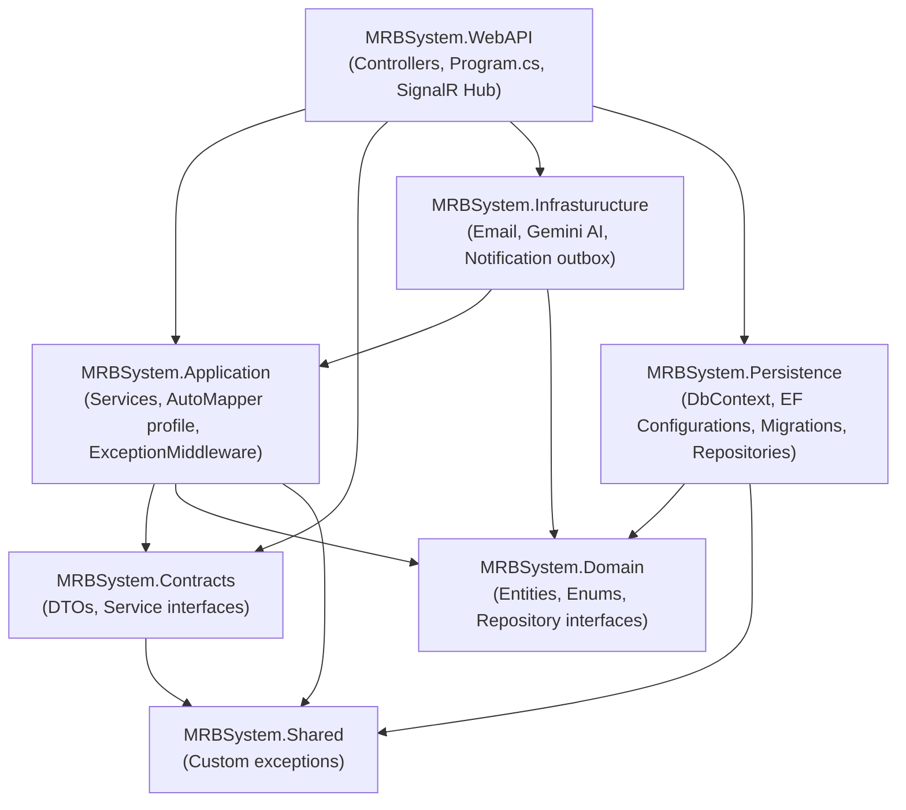

# MeetHub — Meeting Room Booking System

A full-stack meeting room booking platform built as a Code Academy final project. It lets employees search, book, and manage meeting rooms across multiple buildings, while admins manage the entire organization's structure, reservations, and system-wide rules — with an AI chatbot, real-time calendar updates, and email-driven notifications layered on top.

> Backend: **ASP.NET Core 8 Web API**, Clean Architecture, EF Core + SQL Server
> Frontend: **Vanilla HTML/CSS/JavaScript** (ES modules, no framework)

---

## Table of Contents

- [Project Overview](#project-overview)
- [Features](#features)
- [Technology Stack](#technology-stack)
- [Architecture & Project Structure](#architecture--project-structure)
- [Design Patterns & SOLID Principles](#design-patterns--solid-principles)
- [Authentication & Authorization](#authentication--authorization)
- [Database & EF Core Approach](#database--ef-core-approach)
- [Business Logic & Validation Rules](#business-logic--validation-rules)
- [API & DTO Structure](#api--dto-structure)
- [Exception Handling & Logging](#exception-handling--logging)
- [Background & Real-Time Features](#background--real-time-features)
- [Admin Panel](#admin-panel)
- [Testing](#testing)
- [Installation & Setup](#installation--setup)
- [Configuration](#configuration)
- [API Documentation (Swagger)](#api-documentation-swagger)
- [Screenshots / Demo](#screenshots--demo)
- [Future Improvements](#future-improvements)
- [Engineering Highlights](#engineering-highlights)

---

## Project Overview

MeetHub solves a common workplace problem: coordinating shared meeting rooms across several office buildings without double-bookings, manual spreadsheets, or messaging back and forth. It provides:

- A **self-service booking experience** for regular employees — search by date/time/capacity/equipment, book instantly, manage their own reservations.
- A **full administrative back office** for managing buildings, floors, rooms, equipment, working hours, system-wide booking rules, users, and all reservations.
- An **AI assistant** (Gemini function-calling) that can answer questions and search for available rooms conversationally.
- **Real-time calendar updates** via SignalR, so a room's calendar refreshes live for everyone viewing it when a booking changes.

The project was built iteratively through multiple rounds of self-driven security/architecture audits (authorization gaps, IDOR, race conditions, SOLID violations) and live manual testing, rather than being written once and left untouched.

## Features

**For regular users**
- Register with email confirmation, log in, JWT-based sessions with optional "remember me" persistence
- Browse the full room catalog or search for available rooms by date, time range, capacity, building, floor, and equipment
- Book a room, add guest participants by email, edit or cancel a reservation
- Per-room calendar view showing existing bookings and admin-defined blackout periods
- "My Bookings" dashboard (upcoming vs. past)
- In-app notifications (bell) for booking created/updated/cancelled events
- AI chat widget that can look up rooms and answer questions using live data
- Forgot/reset password via a 6-digit emailed code
- Live calendar updates without refreshing (SignalR)

**For admins**
- Fully separate, isolated admin login (email + password + mandatory email 2FA), never cross-linked with the user login/session
- CRUD for Buildings, Floors, Rooms, Equipment, and Room↔Equipment assignments
- Room blackout management (block a room for maintenance, with automatic conflict checking against existing reservations)
- Per-building working-hours configuration (which days/hours a building accepts bookings)
- **System settings with a global default + optional per-building override**: every booking rule (min/max duration, buffer time, booking horizon, active-reservation limit, calendar range) can be set globally or overridden for a specific building, with an explicit "reset to global" action
- User & role management (promote/demote Admin, delete users)
- Reservation oversight across the whole organization
- Dashboard with booking analytics (charts)

## Technology Stack

**Backend**
| Category | Technology |
|---|---|
| Framework | ASP.NET Core 8 (Web API) |
| ORM | Entity Framework Core 8 (Code-First, SQL Server) |
| Auth | ASP.NET Core Identity + JWT Bearer (`System.IdentityModel.Tokens.Jwt`) |
| Object Mapping | AutoMapper |
| Real-time | ASP.NET Core SignalR |
| Logging | Serilog (Console + rolling daily file sinks) |
| API Docs | Swashbuckle (Swagger / OpenAPI) |
| Rate Limiting | `Microsoft.AspNetCore.RateLimiting` (fixed-window, per-IP / per-user) |
| Email | `System.Net.Mail.SmtpClient` (Gmail SMTP) |
| AI | Google Gemini API (function calling), consumed via a typed `HttpClient` — no SDK dependency |
| Testing | xUnit, Moq, FluentAssertions, EF Core + SQLite (in-memory) |

**Frontend**
| Category | Technology |
|---|---|
| Structure | Static HTML pages, vanilla JavaScript (ES modules, no bundler/framework) |
| Styling | Hand-written CSS design system (custom tokens, no CSS framework) |
| Icons | Bootstrap Icons (icon font only) |
| Real-time client | `@microsoft/signalr` (browser client) |

## Architecture & Project Structure

The backend follows **Clean Architecture** with strict inward-pointing dependencies — outer layers depend on inner ones, never the reverse.



```
MeetingRoomBookingSystem/
├── Backend/
│   └── MRBSystem/
│       ├── core/
│       │   ├── MRBSystem.Domain/           # Entities, Enums, IGenericRepository, IUnitOfWork
│       │   ├── MRBSystem.Contracts/        # DTOs (one folder per feature area) + service interfaces
│       │   ├── MRBSystem.Application/      # Service implementations, AutoMapper profile, ExceptionMiddleware
│       │   └── MRBSystem.Shared/           # Cross-cutting custom exceptions
│       ├── infrasturucture/
│       │   ├── MRBSystem.Persistence/      # DbContext, Fluent API configs, migrations, Generic Repository
│       │   └── MRBSystem.Infrasturucture/  # EmailService, GeminiChatService, NotificationDeliveryService
│       ├── presentation/
│       │   └── MRBSystem.WebAPI/           # Controllers, Program.cs, SignalR Hub
│       └── MRBSystem.Testing/              # xUnit test suite
└── Frontend/
    ├── pages/                              # One HTML file per screen
    ├── javascripts/
    │   ├── api/                            # Thin fetch wrappers per backend resource
    │   ├── controllers/                    # One controller script per page
    │   └── components/                     # Shared UI widgets (booking modal, dropdowns, alerts, nav)
    └── css/                                # Design tokens + component/page styles
```

13 controllers expose the API surface: `Auths`, `Buildings`, `Floors`, `Rooms`, `Equipments`, `RoomEquipments`, `RoomBlackouts`, `Reservations`, `Participants`, `Notifications`, `WorkingHours`, `SystemSettings`, `Chat`.

## Design Patterns & SOLID Principles

- **Repository + Unit of Work**: a single `IGenericRepository<T>` (CRUD + `AsNoTracking()` queries) backs every entity, and `IUnitOfWork.ExecuteInTransactionAsync` wraps multi-step operations that must succeed or fail atomically (e.g. reservation conflict-checking under `Serializable` isolation, cascading deletes, registration + role assignment).
- **Dependency Injection** throughout — every service is registered against an interface (`IReservationService`, `IRoomService`, `ISystemSettingsService`, …) and resolved via constructor injection; no service reaches for a concrete dependency directly.
- **DTO + AutoMapper mapping layer**: entities never leave the Application layer — every controller returns a `ResponseXDto`, and every write goes through a `CreateXDto`/`UpdateXDto`, keeping the persistence model decoupled from the wire format.
- **Middleware pipeline pattern**: a single `ExceptionMiddleware` centralizes exception → HTTP status code translation instead of try/catch blocks scattered across controllers.
- **Single Responsibility**: authentication and role/user management were deliberately split into two services (`AuthService` vs. `RoleService`) once the original combined class grew responsibilities beyond "login/register" (found during a self-audit and refactored, not designed that way from day one).
- **Open/Closed**: adding a new booking rule (e.g. per-building override) extended `ISystemSettingsService`'s contract rather than requiring changes to every consumer (`ReservationService`, `RoomService` just call `GetAsync(buildingId)`).
- **Interface Segregation**: each feature area gets its own narrow service interface (`IWorkingHourService`, `IRoomBlackoutService`, …) rather than one large `IAdminService`.
- **Dependency Inversion**: `Application` depends on `IEmailService`/`IChatService` abstractions defined in `Contracts`; the concrete SMTP/Gemini implementations live in the outer `Infrasturucture` layer and are swapped in only via DI registration in `Program.cs`.

## Authentication & Authorization

- **ASP.NET Core Identity** (`AppUser : IdentityUser<Guid>`, `AppRole : IdentityRole<Guid>`) backs user storage, password hashing, and lockout.
- **JWT Bearer** access tokens (60-minute lifetime) + long-lived **refresh tokens** (30 days, stored server-side, rotated on every use — reusing an old refresh token or a revoked one is rejected).
- **Instant revocation via `SecurityStamp`**: every access token carries the user's current `SecurityStamp` as a claim; `Program.cs`'s `OnTokenValidated` handler compares it against the live database value on every request and fails validation on mismatch. This means changing a password or removing a role invalidates existing access tokens immediately, not just future ones.
- **Two separate login flows, fully isolated**: `/auths/user/login` and `/auths/admin/login` are distinct endpoints. Admin login additionally requires a **6-digit email 2FA code** (`/auths/admin/login-2fa`) before tokens are issued. The admin frontend pages never link to or from the regular user pages.
- **Email confirmation required** before login (`RequireConfirmedEmail = true`), enforced by ASP.NET Identity's own sign-in check.
- **Forgot/reset password** via a 6-digit emailed token (reusing Identity's `DataProtectorTokenProvider` configured as the email provider), anti-enumeration by design (identical response whether or not the email exists).
- **Account lockout**: 5 failed attempts locks the account for 15 minutes.
- **Rate limiting**: all auth endpoints (login, 2FA, register, refresh, forgot/reset password) are capped at 5 requests/minute per IP; the AI chat endpoint is capped at 10/minute per user.
- **Role-based authorization**: `[Authorize(Roles = "Admin")]` on every admin-only endpoint; ownership checks (`EnsureCanModify`, `EnsureCanRespond`) additionally guard per-resource access so a user can only see/modify their own reservations and participant records (or those they were invited to).
- **Password policy**: minimum 8 characters, requires upper+lowercase and a digit.
- **Frontend session persistence**: tokens are kept in `sessionStorage` by default (cleared when the tab closes); checking "Remember me" at login switches storage to `localStorage` so the session survives a browser restart, without changing anything server-side.

## Database & EF Core Approach

- **Code-First migrations** — 13 migrations track the schema's evolution (including reversals like removing an unused optimistic-concurrency column, and additions like the per-building `SystemSettings` override).
- **Fluent API only** — every entity has a dedicated `IEntityTypeConfiguration<T>` class (13 in total) in `Persistence/Configurations`; entities themselves carry no EF attributes, keeping the Domain layer persistence-agnostic.
- **Deliberate, non-default delete behaviors**: `Restrict` is used wherever a child entity has independent business meaning (`Floor→Building`, `Room→Floor`, `Reservation→Room` — you cannot delete a room that has any booking history), while `Cascade` is used only for truly dependent rows with no independent existence (`RoomEquipment→Room`, `RoomBlackout→Room`, per-building `SystemSettings`/`BuildingWorkingHour` overrides).
- **Global UTC conversion**: a single `ValueConverter` registered once in `OnModelCreating` forces every `DateTime` property to be stored/read as UTC, eliminating a whole class of timezone bugs at the persistence boundary; local (Asia/Baku) time is only ever computed transiently in the service layer via an injected `ITimeZoneService`.
- **Read-path performance**: the generic repository's query methods use `.AsNoTracking()` uniformly, since every write in the codebase goes through explicit `_dbSet.Update(...)` calls rather than relying on change-tracking.
- **Concurrency control for booking conflicts**: `IUnitOfWork.ExecuteInTransactionAsync` wraps reservation create/update in a `Serializable`-isolation transaction (with `EnableRetryOnFailure`), which is what actually prevents two simultaneous requests from double-booking the same room/time slot.
- **11 entities**: `Building`, `Floor`, `Room`, `Equipment`, `RoomEquipment` (join), `RoomBlackout`, `Reservation`, `Participant`, `Notification`, `RefreshToken`, `BuildingWorkingHour`, `SystemSettings`, plus Identity's `AppUser`/`AppRole`.

## Business Logic & Validation Rules

Two layers of validation exist for a reason:

1. **Field-level validation** — DataAnnotations (`[Required]`, `[StringLength]`, `[Range]`, `[EmailAddress]`, `[Compare]`) on every DTO, auto-enforced by `[ApiController]` with zero extra wiring. String length limits are matched 1:1 against the actual `HasMaxLength` values in the EF configurations so DTO and schema never disagree. `IValidatableObject` catches cross-field issues DataAnnotations can't express (e.g. `StartDate < EndDate`).
2. **Business-rule validation** — lives in the service layer, since it needs database state (existing bookings, per-building settings) that a DTO can't see on its own:
   - A room must be `IsActive` to accept new reservations.
   - A reservation's duration must fall between the effective `MinReservationMinutes` and `MaxReservationHours`.
   - A configurable **buffer** (minutes) is enforced between adjacent bookings for the same room ("cleanup time"), applied consistently in both search-availability and create/update conflict checks.
   - Bookings must fall inside the building's configured **working hours** for that day (extracted into a shared `IWorkingHourService.EnsureWithinWorkingHoursAsync` used by both the search and create/update flows, removing what used to be duplicated logic).
   - Non-admin users cannot book beyond a configurable **booking horizon** (days ahead); admins are exempt.
   - An optional **active-reservation limit** per user can be toggled on/off.
   - Room **blackout periods** (maintenance, etc.) block any overlapping reservation, and creating a blackout itself is rejected if it would overlap an existing confirmed reservation.
   - **All of the above are resolved per-building**: `SystemSettings` has an optional `BuildingId` — a `null` row is the global default, and a building can have its own override row that silently takes priority whenever a room in that building is booked, while other buildings keep following the global default automatically.
   - Ownership: only the reservation's owner or an Admin can modify/cancel it; only a participant, the owner, or an Admin can view a reservation's guest list.

## API & DTO Structure

- REST-ish resource controllers under `/api/{resource}` (e.g. `/api/rooms/search-available`, `/api/reservations/my`, `/api/system-settings/{buildingId}`).
- **54 DTOs** organized into per-feature folders under `Contracts/DTOs/` (`AuthDtos`, `ReservationDtos`, `RoomDtos`, `SystemSettingsDtos`, …), each typically split into `Create*Dto` / `Update*Dto` / `Response*Dto`.
- AutoMapper (`CustomProfile`) maps entity ↔ DTO in both directions; `CreateMap<CreateXDto, Entity>(MemberList.Source)` is used specifically for partial write DTOs, since the default destination-member validation is wrong when `Id`/`CreatedAt`/navigation properties are intentionally left for EF/`BaseEntity` to populate.
- Response DTOs deliberately flatten useful read-only context that would otherwise require a second client request (e.g. `ResponseRoomDto.BuildingName`/`BuildingId`, `ResponseReservationDto.RoomName`/`BuildingName`) — this is computed at mapping time from an already-loaded navigation, never stored redundantly in the database itself.

## Exception Handling & Logging

- **Centralized exception handling**: `ExceptionMiddleware` catches every unhandled exception once, maps known types to the right HTTP status (`NotFoundException` → 404, `ForbiddenException` → 403, `ArgumentException` → 400, `InvalidOperationException`/`DbUpdateException` → 409, anything else → 500), and returns a consistent `{ statusCode, message }` JSON body.
- **Custom exceptions** (`NotFoundException`, `ForbiddenException`) live in `MRBSystem.Shared` so every layer can throw them without a dependency on the Application layer.
- **User-facing messages stay localized (Azerbaijani)** — since they're shown directly in the UI (`"Rezervasiya minimum 30 dəqiqə olmalıdır."`) — while **structured log output is kept in English** throughout (`_logger.LogWarning("{StatusCode}: {ExceptionType}", ...)`), a deliberate separation so logs stay consistent and greppable regardless of what a given business rule's user-facing message says.
- **Serilog** writes structured logs to both Console and a rolling daily file (`Logs/log-.txt`), enriched with the log context.

## Background & Real-Time Features

- **`RoomCalendarHub`** (SignalR, `/hubs/room-calendar`, JWT-authenticated over the WebSocket handshake): clients join per-room groups (`JoinRoom`/`LeaveRoom`) and an `Admins`/`user:{id}` group on connect; `SignalRRoomCalendarBroadcastService` pushes a "calendar changed" event to the relevant room group whenever a reservation is created, updated, or cancelled, so every open calendar view for that room updates live without a manual refresh. The frontend surfaces connection loss/recovery with a visible banner rather than failing silently.
- **`NotificationDeliveryService`** (`IHostedService`): a background outbox worker that sends queued email notifications asynchronously (so a slow SMTP call never blocks the HTTP request that triggered it), retrying the "mark as sent" write up to 3 times before giving up.
- **AI chat** (`GeminiChatService`) uses Gemini's function-calling API to let the assistant call real backend functions (e.g. search available rooms, list buildings) and weave the results into its answer, rather than only generating free text.

## Admin Panel

A fully separate section of the frontend (`admin*.html` pages, its own sidebar shell, its own guard) covering:

- **Dashboard** — booking analytics and at-a-glance stats.
- **Buildings / Rooms / Equipment** — full CRUD, with usage checks before deletion (e.g. equipment in use, a building with existing floors) surfaced as a clean 409 rather than a raw database error.
- **Blackouts** — schedule room downtime, with automatic conflict detection against existing bookings.
- **Working Hours** — per-building weekly schedule editor.
- **Settings** — the global/per-building `SystemSettings` editor described above, including an explicit "reset to global" action for any building that currently has its own override.
- **Users** — role assignment/removal, account deletion (self-delete blocked, and blocked if the user still owns reservations).
- **Reservations** — organization-wide view of every booking.

Every admin page starts with a `requireAdmin()` guard that checks both authentication and the `Admin` role claim from the JWT before rendering anything.

## Testing

- **xUnit** + **Moq** (mocking dependencies like `IEmailService`, `ICurrentUserService`) + **FluentAssertions** (readable assertions).
- **EF Core InMemory via SQLite** (`Microsoft.Data.Sqlite`) backs every service test with a real (if lightweight) relational database rather than mocking `DbContext` directly — this is what actually catches real EF/FK-constraint bugs during test authoring.
- **14 test classes, 84 tests**, one per service (`ReservationService`, `RoomService`, `SystemSettingsService`, `AuthService`, `RoleService`, `ParticipantService`, `NotificationService`, `RoomBlackoutService`, `RoomEquipmentService`, `WorkingHourService`, `BuildingService`, `FloorService`, `EquipmentService`) plus a dedicated `AutoMapperConfigurationTests` that runs AutoMapper's own `AssertConfigurationIsValid()` — this alone has previously caught real mapping bugs (DTOs incorrectly inheriting timestamp fields that don't exist on Identity-based entities) before they reached runtime.
- Run everything with:
  ```bash
  dotnet test Backend/MRBSystem/MRBSystem.Testing/MRBSystem.Testing.csproj
  ```

## Installation & Setup

### Prerequisites
- [.NET 8 SDK](https://dotnet.microsoft.com/download/dotnet/8.0)
- SQL Server (LocalDB, Express, or full) reachable from your machine
- A Gmail account (or other SMTP provider) for outgoing email
- A Google Gemini API key (only required for the AI chat feature)

### Backend

```bash
cd Backend/MRBSystem

# Restore & build
dotnet restore
dotnet build

# Configure secrets (see Configuration section below)
dotnet user-secrets init --project presentation/MRBSystem.WebAPI
dotnet user-secrets set "ConnectionStrings:MRBSystemConnectionString" "Server=.;Database=MRBSystemDb;Trusted_Connection=True;TrustServerCertificate=True" --project presentation/MRBSystem.WebAPI
# ...set the remaining keys listed under Configuration

# Apply migrations (creates the database)
dotnet ef database update --project infrasturucture/MRBSystem.Persistence --startup-project presentation/MRBSystem.WebAPI

# Run the API (must use the "https" launch profile — the frontend depends on it, see below)
dotnet run --project presentation/MRBSystem.WebAPI --launch-profile https
```

The API starts on `https://localhost:7114` (Swagger UI at `/swagger`), and an Admin account is auto-seeded on first run from the `SeedAdmin:*` configuration keys.

### Frontend

The frontend is static — no build step, no npm. Serve the `Frontend/` folder with any static file server (e.g. VS Code's **Live Server** extension) rather than opening the HTML files directly with `file://`, since the API calls need a real HTTP origin for CORS.

> **Important**: the backend must be running on **HTTPS** (`https://localhost:7114`), not HTTP — `Program.cs` runs `UseHttpsRedirection()` before `UseCors()`, so an HTTP-origin CORS preflight would be redirected and rejected by the browser. Always start the backend with the `https` launch profile.

Open `Frontend/pages/landing.html` (public) or `Frontend/pages/login.html` / `adminLogin.html` directly.

## Configuration

All secrets are read via `IConfiguration` and kept out of source control via **.NET User Secrets** in development (never committed to `appsettings.json`).

| Key | Purpose |
|---|---|
| `ConnectionStrings:MRBSystemConnectionString` | SQL Server connection string |
| `Jwt:Key` / `Jwt:Issuer` / `Jwt:Audience` | JWT signing key & validation parameters |
| `Jwt:AccessTokenExpirationMinutes` | Access token lifetime (currently 60) |
| `Jwt:RefreshTokenExpirationDays` | Refresh token lifetime (currently 30) |
| `SeedAdmin:Email` / `SeedAdmin:Password` / `SeedAdmin:FirstName` / `SeedAdmin:LastName` | First-run admin account bootstrap (only used if that email doesn't already exist) |
| `Smtp:Host` / `Smtp:Port` / `Smtp:Username` / `Smtp:Password` / `Smtp:FromEmail` / `Smtp:FromName` / `Smtp:EnableSsl` | Outgoing email (confirmation, 2FA, password reset) |
| `Gemini:ApiKey` | Google Gemini API key for the AI chat feature |
| `Cors:AllowedOrigins` | Array of allowed frontend origins (`appsettings.Development.json`) |
| `Localization:TimeZoneId` | IANA timezone id used for all business-hour calculations (`Asia/Baku`) |
| `Serilog:*` | Sink configuration (Console + rolling file), levels, overrides |

`Frontend/javascripts/api/apiClient.js` has its own `API_BASE_URL` constant pointing at the backend's HTTPS origin — update it if you run the API on a different port/host.

## API Documentation (Swagger)

Swagger UI is auto-enabled in the Development environment at:

```
https://localhost:7114/swagger
```

It includes a configured **Bearer** security scheme — click "Authorize" and paste `Bearer {your-access-token}` to call authenticated endpoints directly from the UI.

## Screenshots / Demo

> _Add screenshots or a short screen recording of the booking flow, the admin dashboard, and the AI chat widget here before sharing this repository._

```
docs/screenshots/
├── landing.png
├── dashboard-booking.png
├── room-calendar.png
├── admin-dashboard.png
└── ai-chat.png
```

## Future Improvements

Tracked deliberately as *not done*, not as oversights — each was evaluated against real trade-offs and postponed for a stated reason:

- **Optimistic concurrency (`RowVersion`) on `Reservation`** — protects against two edits to the *same* reservation racing each other; postponed since it needs a schema migration and the real-world trigger (two edits within milliseconds) is very unlikely at this scale. (Double-booking itself is already prevented via the `Serializable` transaction — this would guard a rarer, secondary case.)
- **`WebApplicationFactory`-based integration tests** — the current suite tests services directly; a real HTTP-pipeline test would additionally verify `[Authorize]`, the rate limiter, and DataAnnotations 400 responses end-to-end.
- **Internationalization (AZ / EN / RU)** — the UI and user-facing messages are currently Azerbaijani-only by design; a full i18n pass would touch every page, controller script, and backend-generated email/message.
- **Pagination** on unbounded list endpoints (`Reservations`, `Notifications`, `Comments`-equivalent) as usage grows.
- **Migrate `EmailService` off the obsolete `System.Net.Mail.SmtpClient`** to a maintained library (e.g. MailKit).
- **Meeting reminder notifications** — infrastructure (`NotificationType`) was drafted and deliberately removed rather than half-finished; a proper implementation needs a polling background job with dedup logic.

## Engineering Highlights

A few things this project was specifically built to demonstrate, rather than happening by accident:

- **Iterative, audit-driven hardening** — the codebase went through multiple full-stack security/architecture audits (authorization/IDOR, race conditions, SOLID violations, N+1s, error handling) with fixes applied and *re-verified*, not just a single initial pass.
- **Deliberate scope discipline** — several half-built or speculative features (`Comment`/`Like`, check-in/QR, an unused `RowVersion` column, `ReservationStatus.Completed`) were found and *removed* rather than "finished for the sake of it," keeping the codebase aligned with what the project actually needs.
- **Correctness verified with real concurrency-relevant tests**, not just happy-path unit tests — e.g. `Serializable`-isolation transactions for the double-booking race, and FK delete-behavior chosen per-relationship (`Restrict` vs `Cascade`) based on actual business meaning rather than defaults.
- **Separation of concerns carried all the way to logging** — user-facing error text and operational log text are two different concerns with two different languages, on purpose.
- **A real, working global/per-resource override pattern** (`SystemSettings`) — a small but genuinely reusable design: a nullable foreign key doubles as both "is this a default" and "is this an override," with zero extra schema for a mode flag.
